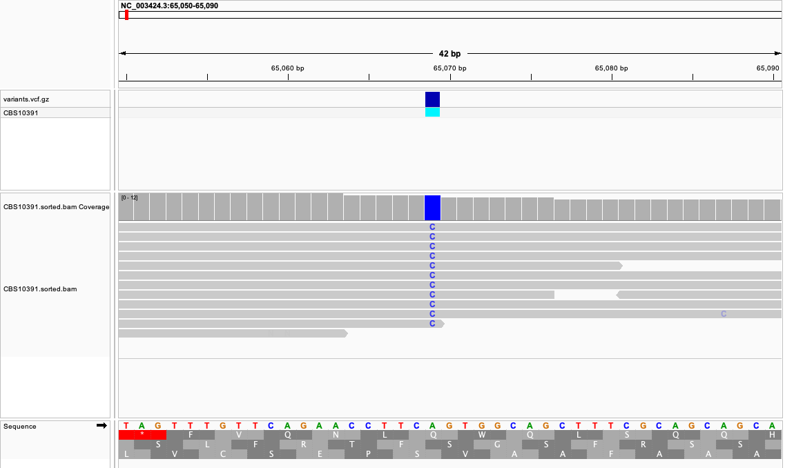
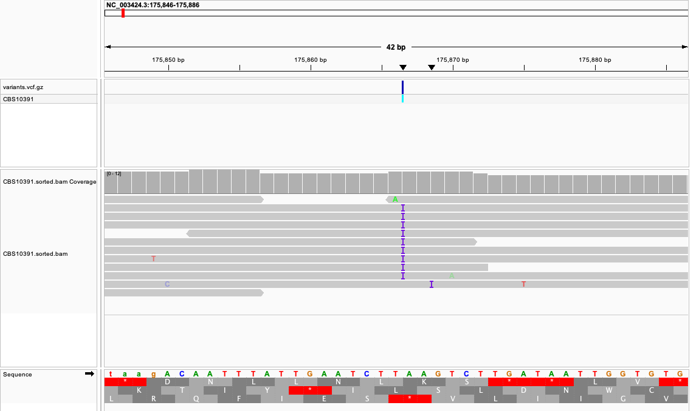
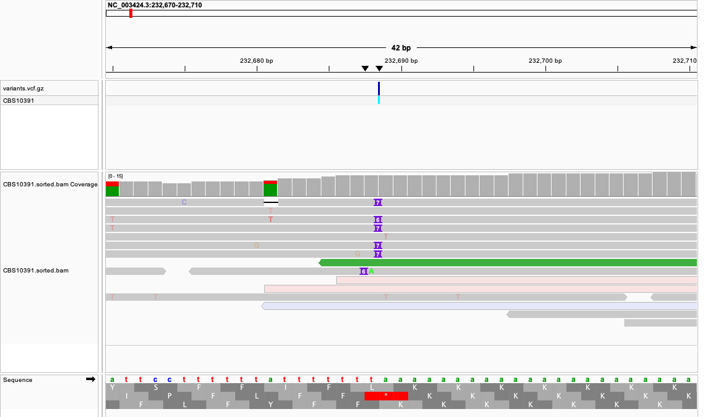

# Week 07：变异检测

英文版见 [README.md](README.md)。

我把裂殖酵母菌株 **CBS10391** 的 reads 比对到参考基因组 **GCF_000002945.2 / ASM294v3**（菌株 **972h-**），并做了变异检测。数据是 Illumina MiSeq 全基因组 DNA，run 为 **SRR1297048**（BioProject PRJNA248418）。这是 DNA 测序，Makefile 用 `bwa mem` 比对，不用 HISAT2。裂殖酵母是单倍体，所以 `bcftools call` 使用 `--ploidy 1`。

FASTQ 和 BWA 索引在 `data/`。BAM、VCF 和统计报告在 `results/`。

## 1. 如何运行 Makefile

需要 GNU Make、`curl`、`gzip`、SRA Toolkit（`fastq-dump`）、BWA、samtools 和 bcftools 都在 `PATH` 上。第一次运行还需要联网。在 `week07/` 目录执行：

```bash
make THREADS=4
```

`N` 默认是 `252837`。SRA 记录的平均 spot 长度是 498 bp，因此这是 12,591,253 bp 基因组的名义 10× 覆盖：

`N = ceil(10 × 12,591,253 / 498) = 252,837` 对双端 reads。

下载到的 reads 长度是 250 bp。两个 FASTQ 文件里同一对 reads 的名字保持一致，这是 `bwa mem` 的要求。

| 命令 | 结果 |
| --- | --- |
| `make genome` | 下载并解压参考 FASTA 到 `data/genome/`。 |
| `make fastq N=252837` | 下载前 `N` 条 spots 到 `data/fastq/SRR1297048/N252837/`。 |
| `make index` | 在 `data/index/` 建立 BWA 索引。 |
| `make align` | 用 `bwa mem` 比对、排序并建立 BAM 索引。 |
| `make vcf` | 调用变异，写入 `results/SRR1297048/N252837/variants.vcf.gz`，并建立 tabix 索引。 |
| `make stats` | 写出 `bcftools stats`、每个变异一行的表格、覆盖度，以及 `flagstat`。 |

主要输出：

- FASTQ：`data/fastq/SRR1297048/N252837/`
- BAM：[`results/SRR1297048/N252837/CBS10391.sorted.bam`](results/SRR1297048/N252837/CBS10391.sorted.bam)
- VCF：[`results/SRR1297048/N252837/variants.vcf.gz`](results/SRR1297048/N252837/variants.vcf.gz)
- 统计：[`bcftools_stats.txt`](results/SRR1297048/N252837/bcftools_stats.txt)、[`variants.txt`](results/SRR1297048/N252837/variants.txt)、[`coverage.txt`](results/SRR1297048/N252837/coverage.txt)、[`depth_summary.txt`](results/SRR1297048/N252837/depth_summary.txt)、[`flagstat.txt`](results/SRR1297048/N252837/flagstat.txt)

## 2. 覆盖度是否达到 10×？

测序量按 10× 设计。主比对 reads 中 **96.41%** 成功比对，**93.97%** 为正确配对。全基因组平均深度是 **9.38×**。**2,051,801 / 12,591,253** 个碱基（**16.30%**）的深度 ≥ 10。覆盖广度很高：每条核染色体大约有 97–98% 的碱基至少被一条 read 覆盖。

| 序列 | 平均深度 | 深度 ≥ 10 的碱基 | 覆盖广度 |
| --- | ---: | ---: | ---: |
| I 号染色体，`NC_003424.3` | 6.54× | 15.63% | 97.50% |
| II 号染色体，`NC_003423.3` | 6.51× | 15.21% | 98.04% |
| III 号染色体，`NC_003421.2` | 9.97× | 19.28% | 98.09% |
| 线粒体，`NC_088682.1` | 1,424× | 83.21% | 93.10% |

I、II 号染色体的平均深度低于 10×，是因为线粒体 reads 占了文库的很大一部分。493,332 条比对上的 reads 里，有 120,968 条落在 19 kb 的线粒体上。`bcftools mpileup -d 100` 把每个位点的 pileup 限制在 100 条 reads，因此线粒体用于变异检测的深度不是原始的 1,424×。

## 3. 检出了多少变异？

共 **87,595** 个变异位点：**78,015** 个 SNP，**9,580** 个 indel。没有 MNP，也没有多等位位点。SNP 的转换/颠换比是 **2.37**（54,832 个转换 / 23,183 个颠换）。这个比值符合 CBS10391 与 972h- 之间的菌株差异，而不是一堆随机测序错误。

| 序列 | 变异数 |
| --- | ---: |
| I 号染色体 | 36,251 |
| II 号染色体 | 32,696 |
| III 号染色体 | 18,465 |
| 线粒体 | 183 |

## 4. 有哪些类型的变异？

大多数 indel 只有 1 个碱基：3,072 个插入，2,894 个缺失。其余从 2 bp 到几十个碱基不等。

SNP 替换计数：

| 替换 | 数量 | 替换 | 数量 | 替换 | 数量 |
| --- | ---: | --- | ---: | --- | ---: |
| A>G | 14,340 | C>T | 13,123 | G>A | 12,995 |
| T>C | 14,374 | A>C | 2,554 | A>T | 5,075 |
| C>A | 2,536 | C>G | 1,414 | G>C | 1,567 |
| G>T | 2,544 | T>A | 4,959 | T>G | 2,534 |

`bcftools stats` 里，被检出位点的深度集中在大约 5–8×，与核基因组的覆盖度一致：

| 深度 | 变异数 |
| --- | ---: |
| 1–2 | 5,897 |
| 3–7 | 52,870 |
| 8–15 | 27,763 |
| ≥ 16 | 1,065 |

## 5. 哪些像真变异，哪些像错误？

我把同时满足下面条件的 SNP 当作菌株差异：比对质量至少 55，深度至少 10，所有 reads 都支持替代等位基因，并且正负链都有这条等位基因。有 **8,834** 个 SNP 满足这个条件。放宽一点的条件是 QUAL ≥ 30、比对质量 ≥ 40、深度 ≥ 8，有 **25,580** 个 call 满足。

两个例子：

- `NC_003424.3:65069` A>C。QUAL 219，深度 10，等位基因深度为 0 条参考 / 10 条替代（正链 5，负链 5），比对质量 60。
- `NC_003424.3:175866` T>TA。QUAL 219，深度 11，等位基因深度 0/11（正链 4，负链 7），比对质量 60。插入的碱基是 A，附近序列不是同聚物。

我把下面这些当作错误：

- 深度为 1 或 2 的 **5,897** 个 call。单倍体基因组上只有一两 reads 与参考不一致，这是测序错误。
- `NC_003424.3:232688` T>TAAAAAAA。QUAL 是 108，比对质量是 56，但这个位点是一段被 soft-mask 的 poly-A。等位基因深度是 3 条参考 / 3 条替代，而且这些计数都只出现在负链上。在 IGV 里，有的 reads 插入 6 个碱基，有的插入 7 个。

还有一类是深度高但比对质量低。在 `NC_003424.3:3761951` 附近，几个 call 的比对质量只有 14–20，MQ0 比例大约是 0.2–0.4。这些 reads 没有唯一比对位置，我不把它们当作菌株差异。

## 6. 比对是否支持这些 call？

上面两个菌株差异的例子，叠在位点上的 reads 都支持该变异。poly-A 那个 call 也能在比对里看到，正是因为这些 reads 彼此不一致，我才把它当作错误。

在 IGV 中打开同一视图：用 **Genomes → Load Genome from File** 载入 `data/genome/GCF_000002945.2_ASM294v3_genomic.fna`。再用 **File → Load from File** 载入 BAM 和 `variants.vcf.gz`。`.bai` 和 `.tbi` 索引与这两个文件放在一起。

在 `NC_003424.3:65,050-65,090`，VCF 轨道标出 `65069` A>C，覆盖到该位点的 reads 都显示 C。



在 `NC_003424.3:175,846-175,886`，VCF 轨道标出插入，reads 上有紫色的插入标记。



在 `NC_003424.3:232,670-232,710`，参考序列是一串 A。插入了额外碱基的 reads 对插入长度并不一致。


