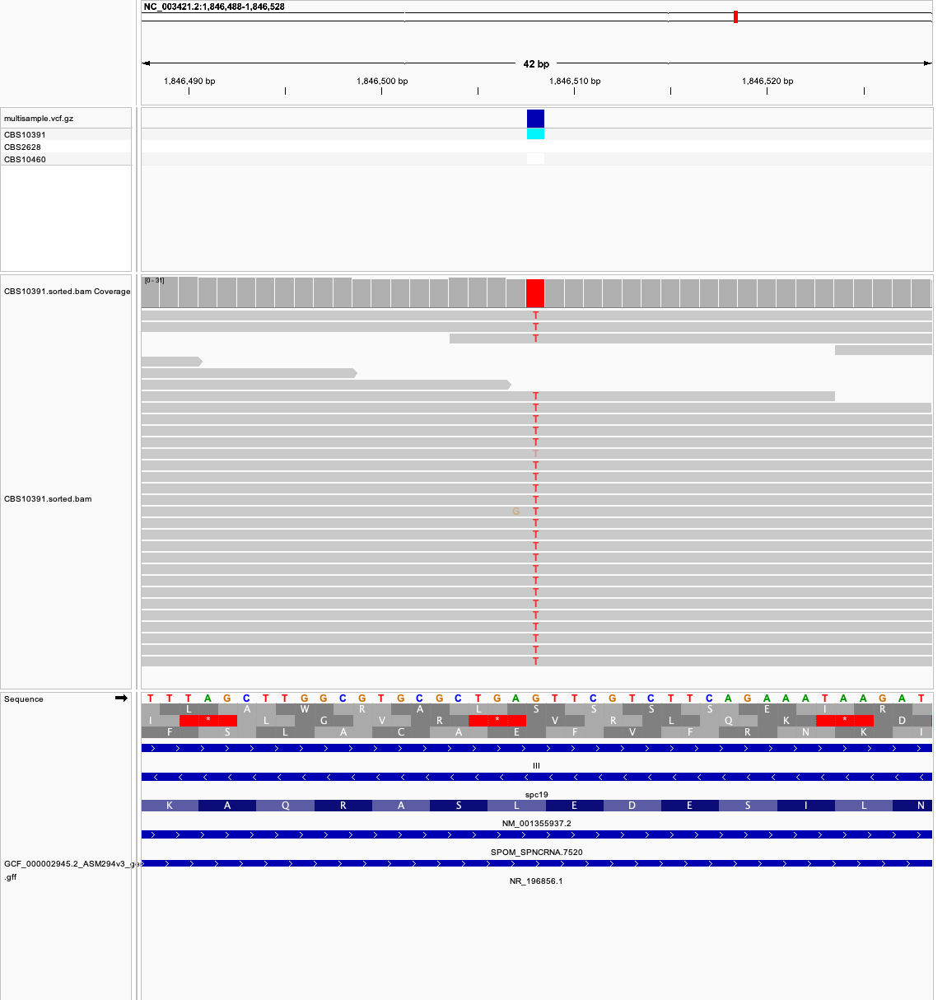

# Week 08: Predict variant effects

I called variants for three *Schizosaccharomyces pombe* strains against the ASM294v3 reference (GCF_000002945.2, strain 972h-), merged the VCFs, and annotated coding SNPs with snpEff. Nuclear genes use the standard genetic code.

The three runs are Illumina MiSeq whole-genome sequencing from BioProject PRJNA248418. Each is a different CBS strain, so the coding sequences contain real differences from 972h-. *S. pombe* is haploid, so `bcftools call` uses `--ploidy 1`.

| Sample | Run | Strain |
|---|---|---|
| CBS10391 | SRR1297048 | CBS10391 |
| CBS2628 | SRR1297050 | CBS2628 |
| CBS10460 | SRR1297012 | CBS10460 |

About 10× coverage is `N = ceil(10 × 12,591,253 / 498) = 252837` read pairs. SRR1297012 has a spot length of 496 bp, so the same `N` is slightly under 10×.

## 1. Running the Makefile

From `week08/`, with `make`, `curl`, `fastq-dump`, BWA, samtools, bcftools, and snpEff on `PATH` (`micromamba activate bioinfo`):

```bash
make THREADS=4
```

That builds one VCF per sample, merges them, builds a snpEff database for ASM294v3, and writes the annotated VCF. The same steps one at a time:

```bash
make vcf SRR=SRR1297048 SAMPLE=CBS10391 N=252837
make vcf SRR=SRR1297050 SAMPLE=CBS2628 N=252837
make vcf SRR=SRR1297012 SAMPLE=CBS10460 N=252837
make merge
make annotate
```

`make merge` runs `bcftools merge` on the three single-sample VCFs. A sample that matched the reference at a site has no record in its own VCF, so the merged genotype is `.` rather than `0`. 

`make annotate` builds `data/snpeff/ASM294v3` from the reference FASTA and GFF, then runs snpEff. The packaged snpEff databases do not use these RefSeq chromosome names (`NC_003424.3`, `NC_003423.3`, `NC_003421.2`, `NC_088682.1`), so the database is built locally. 

`scripts/snpeff_gff.py` keeps gene, mRNA, and CDS features and names each CDS with the PomBase gene symbol.

Main outputs:

- `results/multisample.vcf.gz`
- `results/multisample.ann.vcf.gz`
- `results/snpEff_summary.html`
- `results/snpEff_summary.genes.txt`

The merged file has 120,876 variant records.

## 2. Annotated variants

I kept SNPs whose snpEff HGVS.c coordinate matches the position in the spliced CDS from the GFF. The codon is read from that CDS with the standard genetic code. On the minus strand the coding base is the complement of the genomic base.

| Location | Gene | Strand | Sample | Genomic change | Reference codon | Alternate codon | Amino acid |
|---|---|---|---|---|---|---|---|
| NC_003421.2:1846508 | spc19 | minus | CBS10391 | G>T | CTC | ATC | Leu → Ile |
| NC_003424.3:250480 | mod21 | minus | CBS10460 | A>G | GTT | GTC | Val → Val |
| NC_003424.3:1559290 | pga1 | plus | CBS2628 | A>T | AAA | TAA | Lys → Ter |

spc19 is a missense change, `c.166C>A` / `p.Leu56Ile`. All 26 reads in CBS10391 are T. The other two samples have no call at this site.

mod21 is synonymous, `c.234T>C` / `p.Val78Val`. All 13 reads in CBS10460 are G. GTT and GTC both encode valine.

pga1 is a stop gain, `c.526A>T` / `p.Lys176*`. All 11 reads in CBS2628 are T. AAA is lysine and TAA is a stop codon.

## 3. IGV

The view below is CBS10391 at spc19. The reads show T where the reference is G. spc19 is on the minus strand, so that genomic G is a C in the codon. The CDS translation under the gene shows leucine at this codon. Replacing that C with A changes CTC to ATC, which is isoleucine.



## 4. snpEff output

These are the `ANN` values for the three variants. The spc19 line is the variant in the screenshot.

```text
T|missense_variant|MODERATE|spc19|GENE_spc19|transcript|rna-NM_001355937.2|protein_coding|3/3|c.166C>A|p.Leu56Ile|166/459|166/459|56/152||
G|synonymous_variant|LOW|mod21|GENE_mod21|transcript|rna-NM_001018259.3|protein_coding|2/2|c.234T>C|p.Val78Val|234/2034|234/2034|78/677||
T|stop_gained|HIGH|pga1|GENE_pga1|transcript|rna-NM_001356020.2|protein_coding|3/3|c.526A>T|p.Lys176*|526/537|526/537|176/178||
```
