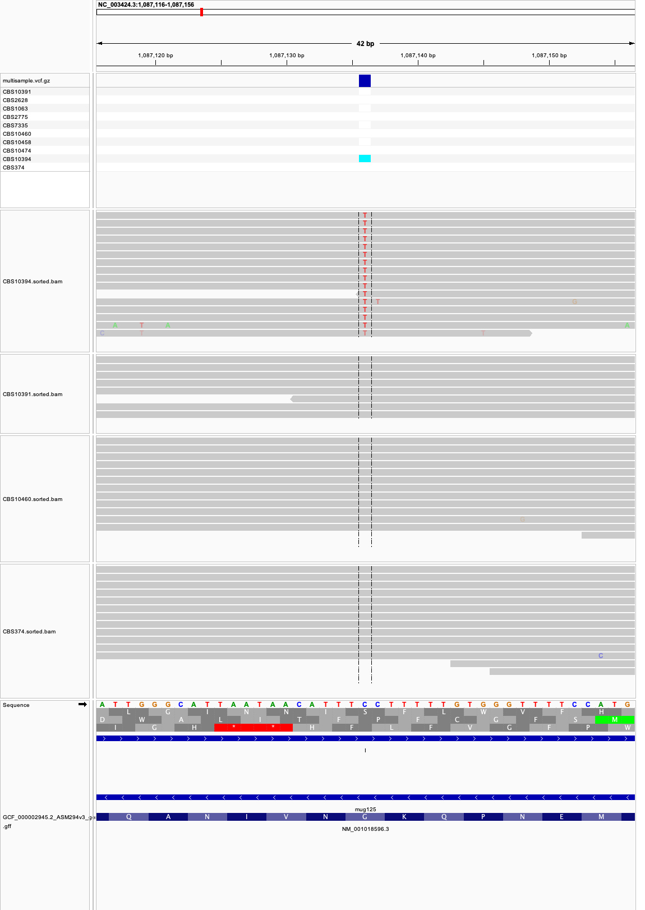
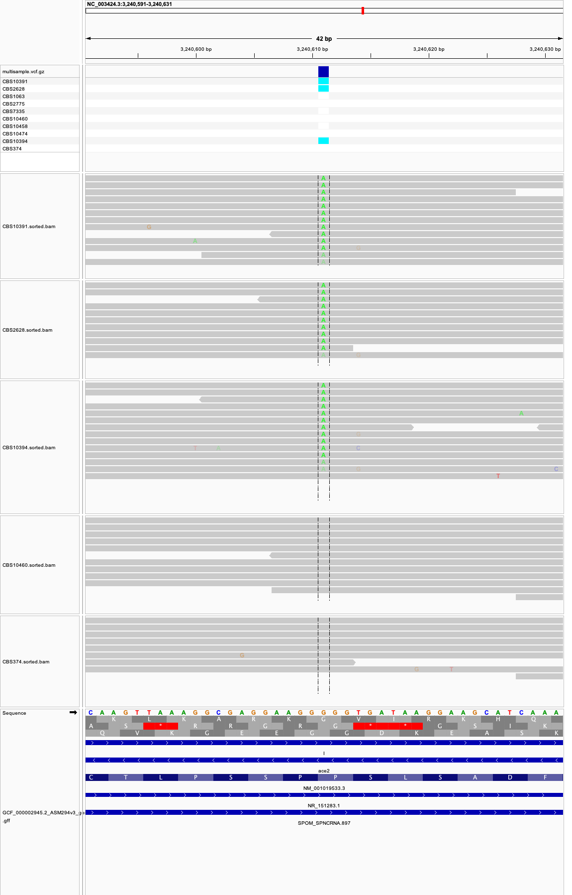
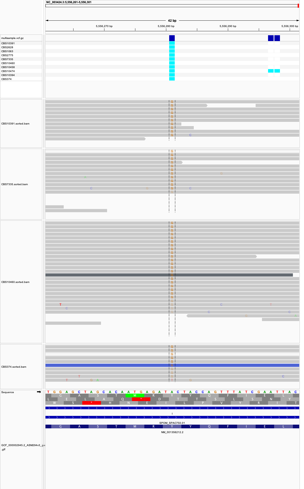

# Week 09: Batch variant calling

I called variants for ten *Schizosaccharomyces pombe* strains from BioProject PRJNA248418 and merged the VCFs. The reference is ASM294v3 (GCF_000002945.2), the lab strain 972h-. 

## 1. The BioProject

NCBI BioProject PRJNA248418 is titled "Schizosaccharomyces pombe Genome sequencing" and is described as resequencing of *S. pombe* strains. The reads are Illumina MiSeq paired-end whole-genome sequencing. The strains came from the CBS-KNAW culture collection.

The project has 42 runs and 32 BioSamples, aliased pombe01 through pombe32. Ten of the strains were sequenced twice. I kept one run per strain, the one with more reads, and took the first ten aliases. Those ten rows are `design.csv`. `Run` is the SRA accession passed to `make` as `SRR`. `Sample` is the CBS strain name, written into the BAM read group and used as the VCF sample name.

The run list came from the ENA filereport for PRJNA248418. The strain name is the `strain` attribute on each BioSample.

## 2. How to reproduce

From `week09/`, with `make`, `curl`, `gzip`, GNU `parallel`, `fastq-dump`, BWA, samtools, and bcftools on `PATH` (`micromamba activate bioinfo`; `fastq-dump` comes from the SRA Toolkit):

```bash
make batch-dry
make batch
```

`make batch-dry` prints the ten commands and does not run them. `make batch` does four things:

1. Download ASM294v3 and build the BWA index once. These files are shared, so they are not built inside the parallel jobs.
2. Read `design.csv` with `parallel --colsep , --header :` and run `make all` for each row. The default is three jobs (`JOBS=3`) and three threads per job (`THREADS=3`).
3. Merge the ten VCFs with `bcftools merge`.
4. Write `results/summary.tsv`.

To call variants for the default sample, SRR1297048 (CBS10391):

```bash
make all
```

*S. pombe* has one copy of each chromosome, so the VCF step runs `bcftools call --ploidy 1`.

The genome is 12,591,253 bp and the spot length of these runs is about 498 bp, so nominal 10× coverage is

N = ceil(10 × 12,591,253 / 498) = 252,837

read pairs. That is the default `N`. Ten samples at this depth finished on a 12-core, 24 GB machine in a few minutes of alignment per sample. Override the limits with `make batch JOBS=2 THREADS=4` if the machine is smaller. `JOBS` times `THREADS` should stay under the number of physical cores.

Main outputs:

- `results/<SRR>/N252837/<sample>.sorted.bam`
- `results/<SRR>/N252837/variants.vcf.gz`
- `results/multisample.vcf.gz`
- `results/summary.tsv`

A sample that matches the reference at a site has no record in its own VCF, so the merged genotype is `.` rather than `0`. I checked the alignments before treating a missing genotype as a reference match.

## 3. Three sites checked in IGV

Codons below are read from the RefSeq CDS on ASM294v3 with the standard genetic code. On the minus strand the coding base is the complement of the genomic base. Read counts are reads with mapping quality and base quality of at least 20.

**CBS10394 carries a private missense SNP in mug125.** At NC_003424.3:1087136 the reference is C and CBS10394 is T. All 14 filtered reads in CBS10394 are T (VCF depth 16). The other nine strains have only the reference base. mug125 is on the minus strand, so this is `c.98G>A` / `p.Gly33Glu`.



**Three strains share a synonymous SNP in ace2.** At NC_003424.3:3240611 the reference is G. CBS10391, CBS2628, and CBS10394 are A on every read that covers the site (VCF depths 12, 10, and 13). CBS10460, CBS374, and the other strains that have coverage match G. ace2 is on the minus strand, so this is `c.357C>T` / `p.Pro119Pro`. CCC and CCT both encode proline.



**All ten strains differ from 972h- at an aldo/keto reductase.** At NC_003424.3:5556281 the reference is A and every filtered read in all ten strains is G. The gene is SPOM_SPAC750.01, on the plus strand: `c.491A>G` / `p.Tyr164Cys`. This is a difference between the reference strain and this set of CBS strains, not a mutation private to one sample. The VCF track shows the same allele in the samples whose BAMs are not drawn here.


