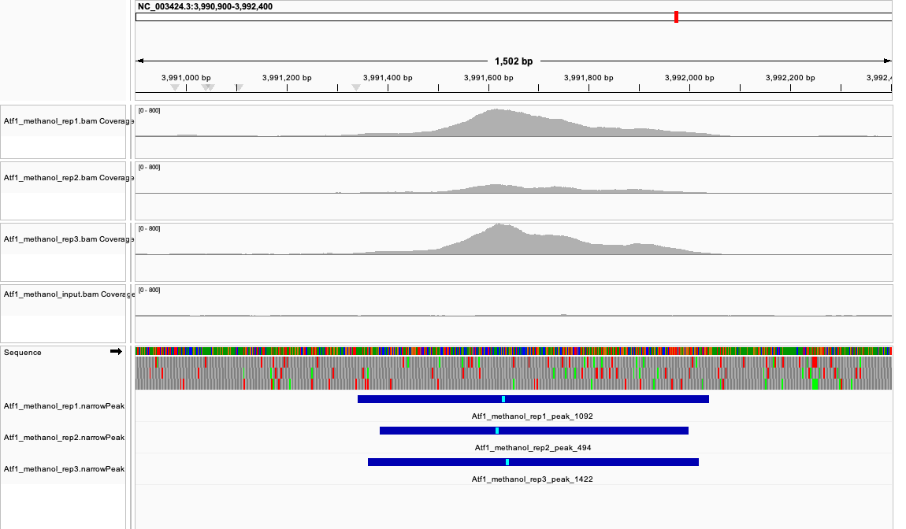
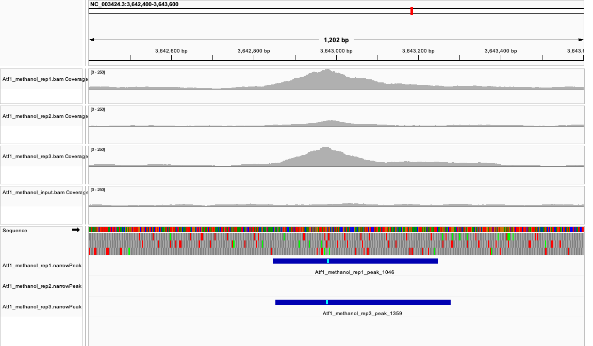

# Week 10: ChIP-seq peak calling

I called Atf1 peaks for two *Schizosaccharomyces pombe* treatments from BioProject PRJNA1052023. The reference is ASM294v3 (GCF_000002945.2). Each ChIP sample is compared with one shared Input control.

## 1. Summay of the project

NCBI BioProject PRJNA1052023 is GEO series GSE250092, from the paper *Nitrogen signaling factor triggers a respiration-like gene expression program in fission yeast* (The EMBO Journal, 2024; PMID 39256560). The assay is paired-end Illumina ChIP-seq of the bZIP transcription factor Atf1. Atf1 binds short sites, so the peaks are called in narrow mode.

The series has 108 samples across six transcription factors. `design.csv` keeps the Atf1 samples from the two-hour treatments. Methanol is the vehicle. NSF is the nitrogen signaling factor. Each treatment has three FLAG-IP replicates. SRR27198380 is Input chromatin from the methanol culture, used as the background for every ChIP sample. The zero-hour samples are not included.

| Run | Sample | Group | Role |
| --- | --- | --- | --- |
| SRR27198371 | Atf1_methanol_rep1 | methanol | ChIP |
| SRR27198370 | Atf1_methanol_rep2 | methanol | ChIP |
| SRR27198369 | Atf1_methanol_rep3 | methanol | ChIP |
| SRR27198368 | Atf1_NSF_rep1 | NSF | ChIP |
| SRR27198351 | Atf1_NSF_rep2 | NSF | ChIP |
| SRR27198350 | Atf1_NSF_rep3 | NSF | ChIP |
| SRR27198380 | Atf1_methanol_input | input | background |

The nuclear chromosomes of ASM294v3 total 12,571,820 bp. The mitochondrion (NC_088682.1, 19,433 bp) is in the alignment reference and is left out of the MACS3 genome size.

## 2. How to reproduce

From `week10/`, with `make`, `curl`, `gzip`, GNU `parallel`, `fastq-dump`, BWA, samtools, bedtools, and MACS3 on `PATH`:

```bash
micromamba activate bioinfo
make batch-dry
make batch
```

`make batch` does four things:

1. Download ASM294v3 and build the BWA index once.
2. Align the Input sample (`make background`).
3. Read the ChIP rows of `design.csv` with `parallel --colsep , --header :` and run `make all` for each row. The default is two jobs (`JOBS=2`) and four threads per alignment (`THREADS=4`).
4. Write `results/summary.tsv` and `results/consistency.tsv`.

The libraries are paired-end, 2×56 bp. The largest selected run has 4,352,437 spots, so the default `N=10000000` returns every read. A smaller `N` keeps the first `N` spots.

To process one ChIP sample, including the Input BAM if it is not already built:

```bash
make all
```

That default is SRR27198371 (Atf1_methanol_rep1). Another sample:

```bash
make all SRR=SRR27198368 SAMPLE=Atf1_NSF_rep1
```

Reads are paired, so MACS3 is given `-f BAMPE`. It skips the strand-shift model and takes the fragment length from the sequenced pairs. On these samples that length is 165–184 bp. Narrow mode is the default, and the same q-value is used for every sample:

```bash
macs3 callpeak -t CHIP.bam -c Input.bam -f BAMPE -g 12571820 -q 0.01
```

In IGV the coverage is the track drawn from the BAM, and the calls are the narrowPeak file. `make tracks` writes the symlinks used by `igv_batch.txt`.

Main outputs:

- `results/<SRR>/N10000000/<sample>.sorted.bam`
- `results/<SRR>/N10000000/peaks/<sample>_peaks.narrowPeak`
- `results/summary.tsv`
- `results/consistency.tsv`

## 3. How many peaks were called in each sample?

`make batch` wrote the peak counts below. The Input sample is only the background, so it has no peak calls.

| Sample | Run | Group | Peaks |
| --- | --- | --- | --- |
| Atf1_methanol_rep1 | SRR27198371 | methanol | 1,247 |
| Atf1_methanol_rep2 | SRR27198370 | methanol | 557 |
| Atf1_methanol_rep3 | SRR27198369 | methanol | 1,633 |
| Atf1_NSF_rep1 | SRR27198368 | NSF | 670 |
| Atf1_NSF_rep2 | SRR27198351 | NSF | 767 |
| Atf1_NSF_rep3 | SRR27198350 | NSF | 631 |

Methanol rep2 is the outlier: only 38.78% of its reads align to ASM294v3, so it yields about half as many peaks as the other methanol replicates. In methanol rep1 the median peak is 399 bp. No peaks were called on the mitochondrion.

## 4. How consistent are the peak calls within replicates?

I compared replicates in pairs. For NSF the Jaccard values are 0.62, 0.59, and 0.55, and 414 of the rep1 peaks are also called in both other replicates. Methanol rep1 against rep3 is 0.62. Rep2 against the other two is 0.33 and 0.28: most peaks it calls are shared, and it misses many that both of the others call.

**The three methanol replicates agree at a strong site on chromosome I.** On NC_003424.3 each replicate calls one peak over the same interval:

- rep1: 3,991,340–3,992,039 (699 bp), fold enrichment 16.3, `-log10` q-value 718
- rep2: 3,991,383–3,991,998 (615 bp), fold enrichment 12.1, `-log10` q-value 168
- rep3: 3,991,361–3,992,019 (658 bp), fold enrichment 18.3, `-log10` q-value 761

Mean depth over rep1's interval is 284, 94, and 302 in the three ChIP replicates, and 26 in the Input. The NSF replicates call the same site. The screenshot is the BAM coverage IGV draws, plus the narrowPeak calls, on a shared depth scale of 0–800.



**A weaker methanol call is missing from rep2.** At NC_003424.3:3,642,846–3,643,247, MACS3 calls a 401 bp peak in methanol rep1 (fold enrichment 5.4, `-log10` q-value 119) and a 426 bp peak in rep3 (3,642,852–3,643,278, fold enrichment 5.6, `-log10` q-value 109). Rep2 has no peak there. Mean depth over the rep1 interval is 120 in rep1, 29 in rep2, 105 in rep3, and 28 in the Input, so rep2 looks like the Input. The screenshot uses a depth scale of 0–250. The three NSF replicates do call this site, so the miss is inside the methanol group, where rep2 has many fewer aligned fragments.


