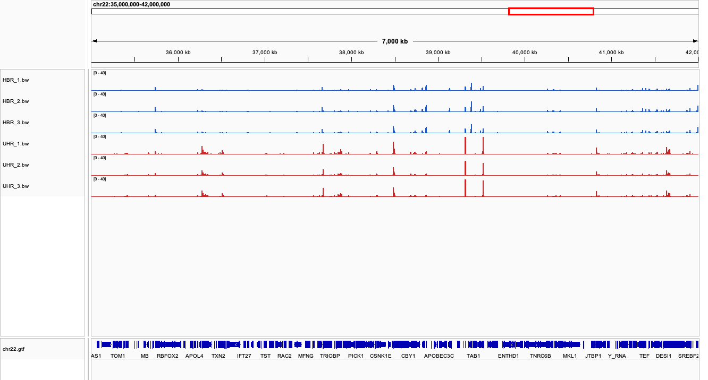
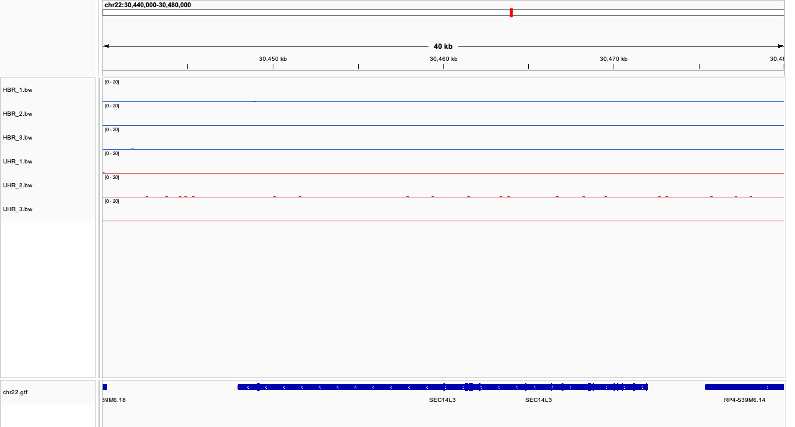
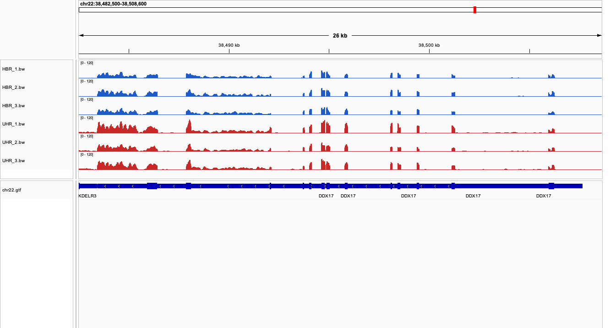
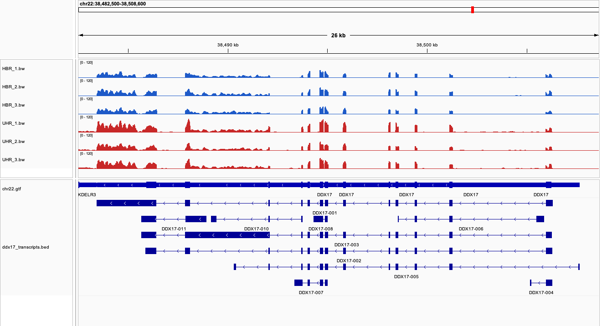
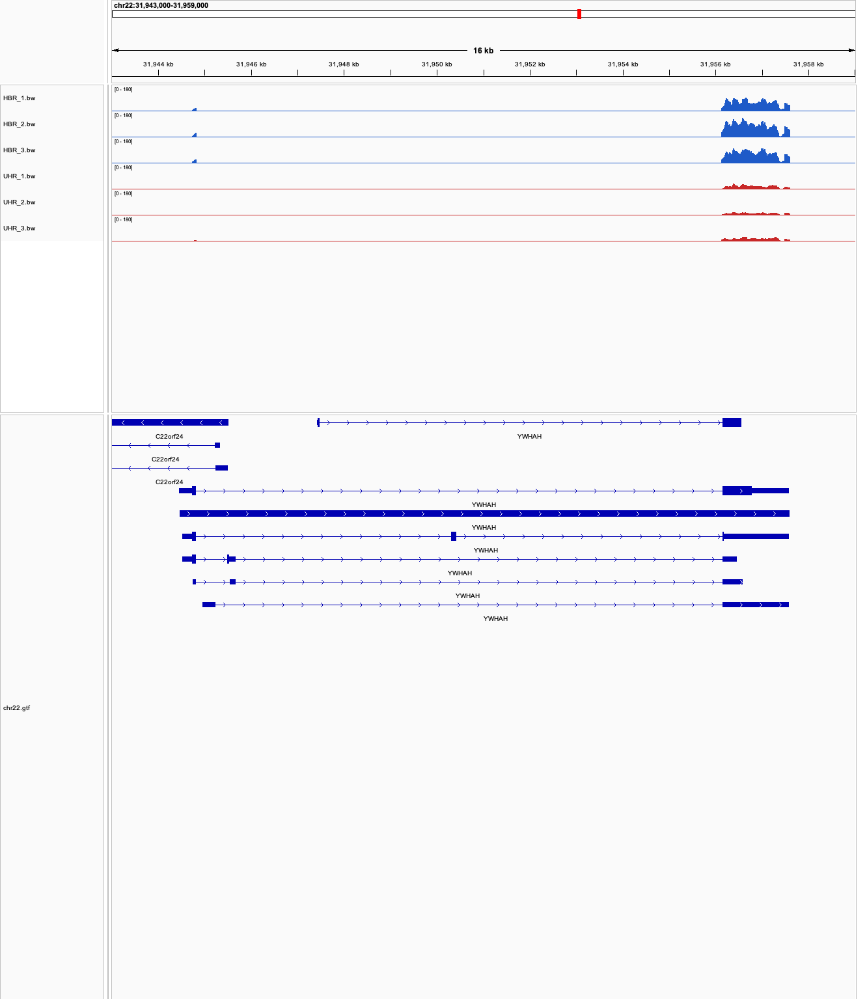
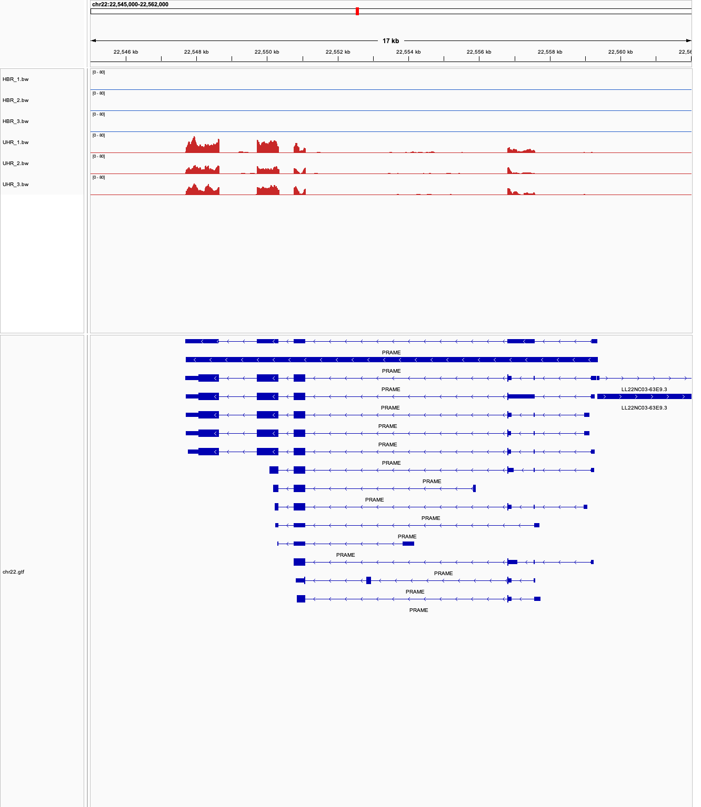

# Week 11: Evaluate gene expression

I aligned the brain (HBR, blue) and cancer cell line (UHR, red) RNA-Seq samples and compared their coverage in IGV.

## 1. How are the two sample types different?

Different genes are expressed in each group. UHR has tall peaks at RPL3, ATF4, and MYH9 that are much lower in HBR, while HBR has peaks where the UHR tracks are low. Some genes, such as DDX17, look similar in both. The UHR tracks are taller overall, partly because the UHR libraries have more reads.

## 2. How consistent are the replicates?

Very consistent. The three replicates of each group show the same peaks with the same shapes. UHR_1 is a little taller than the other UHR tracks because its library is the largest.

## 3. A gene not expressed in any sample

SEC14L3 has no coverage over any exon in any sample.

## 4. A gene strongly expressed in all samples

DDX17 is covered on every exon in all samples. The peak coverage is about 60-110× in both groups.

## 5. Which transcripts are expressed?

IGV labels each GTF row with the gene name only, so I extracted the 10 DDX17 transcripts from the GTF into `ddx17_transcripts.bed`, named by transcript, and loaded it as an extra track.

Coverage can only exclude some isoforms (DDX17 is on the minus strand, so its 5′ end is on the right). DDX17-004, DDX17-005, and DDX17-006 each have a 5′ exon with no reads, so they are unlikely. The long 3′ end of DDX17-001 is covered, which supports it. Most introns are empty, but the one retained in DDX17-003 has some reads, so that isoform may be present at a low level. The other isoforms share the covered exons and cannot be told apart.

## 6. A gene that differs between the two sample types

YWHAH's last exon peaks at about 115-175× in HBR and about 25-45× in UHR, a fold change of about 4. UHR libraries are larger, so the real difference is somewhat bigger.

PRAME has no coverage in HBR and about 40–80× in UHR.

## 7. Is the transcript upregulated or downregulated?

YWHAH is upregulated in HBR (downregulated in UHR). PRAME is upregulated in UHR.

## 8. How certain is it?

For YWHAH, fairly certain. All three HBR replicates are clearly higher than all three UHR replicates, with no overlap. The difference is much larger than the variation between replicates, and correcting for library size would only make it bigger. 

PRAME is even clearer, all three UHR replicates are covered and all three HBR replicates are empty. A caveat for both is that there are only three replicates, and they come from pooled commercial RNA, so a formal statistical test would still be needed.
