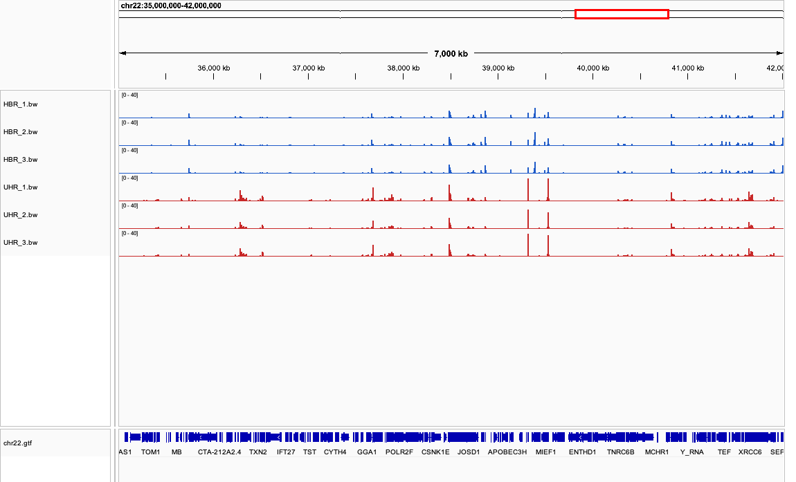
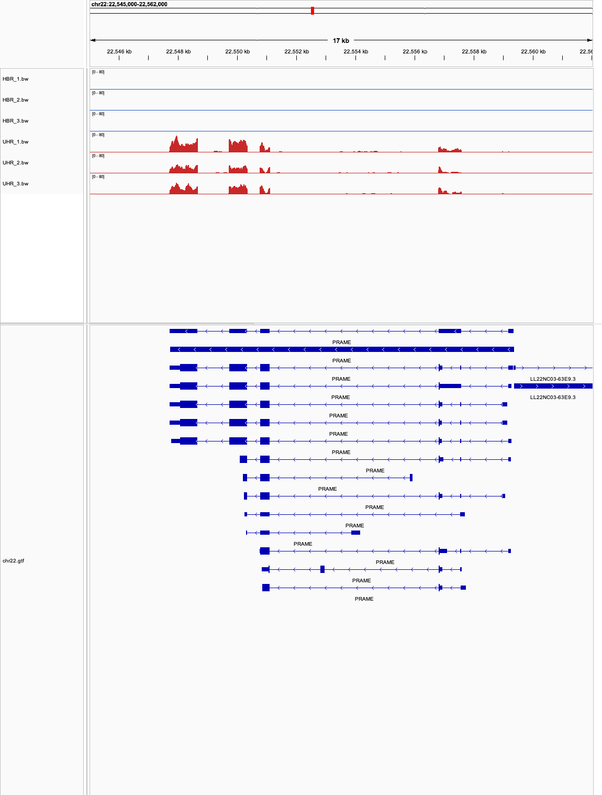
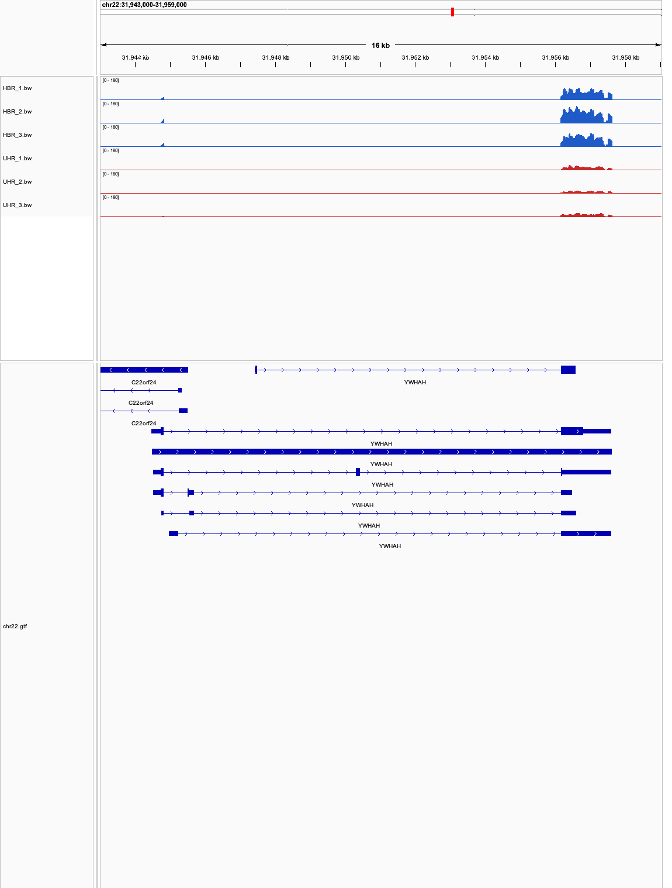

# Week 12: Generate a count matrix

I quantified the brain (HBR) and cancer cell line (UHR) RNA-Seq samples against the chr22 transcriptome with Salmon, then combined the results into a transcript-level and a gene-level count matrix, each with gene names.

## 1. How to run

Requirements:

- Salmon and GNU parallel, for the quantification
- R with the Bioconductor package `tximport`, for the count matrices

Run all commands in this directory:

```bash
# Download the data, build the Salmon index, and quantify every sample
make data
make batch

# Build both count matrices
make matrix
```

`make matrix` runs the two R scripts in order. They can also be run directly:

```bash
# Transcript-level counts -> results/transcript_counts.csv
Rscript src/transcript_counts.r

# Gene-level counts -> results/gene_counts.csv
Rscript src/gene_counts.r
```

## 2. Results

`results/transcript_counts.csv` has 4501 transcripts and `results/gene_counts.csv` has 1369 genes. Each row has a gene name, and each column is a sample from `design.csv`. The values are estimated read counts, so they are not always whole numbers.

At the transcript level the counts can jump between isoforms of the same gene from one replicate to the next, because isoforms share most of their sequence. The gene-level totals are much more consistent between replicates.

The gene counts for the genes I looked at in IGV last week:

```
gene,name,HBR_1,HBR_2,HBR_3,UHR_1,UHR_2,UHR_3
ENSG00000100012.11,SEC14L3,0,0,0,0,0,0
ENSG00000100201.18,DDX17,1517.999,1783,1613,2787.001,1786,2214.999
ENSG00000128245.14,YWHAH,1027.001,1354,1145.001,333,217.999,293
ENSG00000185686.17,PRAME,0,0,0,809,462,596
ENSG00000100316.15,RPL3,653.999,753.999,717.001,4008.999,2393,3036
ENSG00000128272.14,ATF4,288,353,306,1346,817,1053
ENSG00000100345.20,MYH9,433,486,470,2623,1575,2067.999
```

The count matrix supports what I saw in IGV:

- **SEC14L3** had no coverage, and it has zero counts in every sample.
- **DDX17** looked strongly expressed in both groups, and it is the most highly expressed gene on chr22 in this data set. After accounting for the larger UHR libraries, the two groups are about the same.
- **YWHAH** looked about 4 times higher in HBR. The counts show about 4 times more reads in HBR, and about 5.5 times after accounting for library size.
- **PRAME** had coverage only in UHR, and it has zero counts in all HBR samples and hundreds in all UHR samples.
- **RPL3, ATF4, and MYH9** had tall peaks in UHR. They are among the most highly expressed genes, about 3 times higher in UHR after accounting for library size.







## 3. AI prompting and challenges

The prompt I used to write the R scripts:

> I ran salmon on all six samples with the @Makefile and @design.csv, and each sample now has a quant.sf like @counts/HBR_1/quant.sf. Can you write an R script that puts all the samples into one transcript count matrix, one column per sample, named like in design.csv? Use the estimated counts, not TPM. tximport should already be installed. Then I need a second script that adds up the transcripts of each gene into a gene count matrix. Both tables should show the gene name on every row. The GTF in gtf/chr22.gtf has the gene names, so maybe take them from there. Put the scripts in src/ and the results in results/.

The main challenge was missing transcripts. The transcript FASTA has 4506 transcripts, but my matrix had only 4501 rows. The script ran without errors, so I only noticed because I counted the rows. The Salmon log showed that when it builds the index, it removes transcripts whose sequence is an exact copy of another transcript and gives their reads to the copy it keeps. Because of this, two small genes that consist only of such duplicates are missing from the gene matrix as well.
